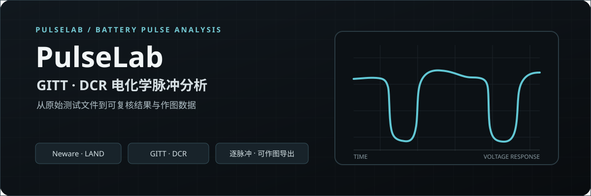

<div align="center">
  

  <h1>让每一段脉冲，都有迹可循</h1>
  <p>面向电池材料研究的 GITT / DCR 本地分析工作台：从原始测试文件到可复核结果与作图数据。</p>
  <p><sub>Traceable analysis for electrochemical pulse data.</sub></p>

  <a href="package.json"></a>
  <a href="src-tauri/tauri.conf.json"></a>

  <p>
    <a href="#项目简介">项目简介</a> ·
    <a href="#核心能力">核心能力</a> ·
    <a href="#分析流程">分析流程</a> ·
    <a href="#快速开始">快速开始</a> ·
    <a href="#导出作图数据">导出作图数据</a> ·
    <a href="#能力边界">能力边界</a>
  </p>
</div>

---

## 项目简介

PulseLab 帮助电池材料研究者整理 Neware 与 LAND 脉冲测试数据，查看 GITT / DCR 分析结果，并导出可在 Origin 等绘图软件中继续作图的数据。

## 核心能力

| 使用场景 | 当前功能 |
| --- | --- |
| 批量查看测试 | 导入支持的 `.ndax`、`.cex` 文件，按样品查看原始曲线与分析事件。 |
| DCR 分析 | 识别小电流放电、静置和大电流放电事件，查看差分 DCR 结果及诊断信息。 |
| CFₓ / FGS GITT | 查看中值电压展示范围内的电压–时间曲线、单脉冲响应，以及以放电中值电压为横坐标的 WH Endpoint 比较结果。 |
| 复核与比较 | 保留逐脉冲结果和 QC 信息；共同电压范围只筛选实测点，不插值补点。 |

## 分析流程

1. 导入测试文件，软件按支持的文件配置读取时间、电压、电流及工步信息。
2. 查看样品分类、曲线和逐脉冲结果；必要时检查协议状态与诊断原因。
3. 导出分组后的 XLSX 数据，在绘图软件中继续比较或复核。

## 快速开始

当前仓库核验到的启动方式是 Windows 源码运行。需要安装 Node.js（含 npm），首次运行会安装项目依赖：

```powershell
git clone https://github.com/Jakiewbe/GITT-DCRMaster.git
cd GITT-DCRMaster
npm install
& ".\启动 PulseLab.cmd"
```

启动脚本会运行本机服务，并在浏览器打开 PulseLab。当前仓库没有登记可验证的公开安装包下载地址；以上是源码启动方式，不是免安装包。

## 导出作图数据

| 分析 | 可直接作图的数据 |
| --- | --- |
| DCR | 时间–电压曲线（时间取整为分钟）；50、150、250、350 min 对应的四个 DCR 值。 |
| GITT | 中值电压展示范围内的时间–电压、静置–脉冲–静置、√τ–电压原始点；另含全部合格点和共同电压范围两张 D–中值电压表。 |

GITT 共同电压范围不生成新测量值；未拟合的 √τ–电压数据保留原始点，已排除 loaded *t* = 0。项目汇总 XLSX 将 DCR、GITT 和清单分别放在不同工作表中。

## 能力边界

- CFₓ WH Endpoint 是受协议与模型适用性限制的表观比较指标，不等同于已经证实的本征 Li⁺ 固相扩散系数。
- LAND CEX 仅支持已检查的 BTS V7 文件配置，解析 profile 仍为 provisional，并非厂商认证格式。
- Neware 与 LAND 的支持范围取决于软件已适配的文件版本和工步配置；无法识别的配置不会被当作已验证数据处理。

## 文档

- [CFₓ GITT 计算口径与适用范围](docs/science/CFX_GITT_10S.md)
- [LAND CEX 文件解析说明](docs/science/LAND_CEX_BINARY_V1.md)
- [0.1.0-beta.2 更新说明](docs/RELEASE_NOTES_0.1.0-beta.2.md)
- [第三方软件声明](THIRD_PARTY_NOTICES.md)

## 许可证

PulseLab 应用源码目前尚未声明开源许可证。`THIRD_PARTY_NOTICES.md` 仅说明第三方组件，不构成 PulseLab 本身的授权。
