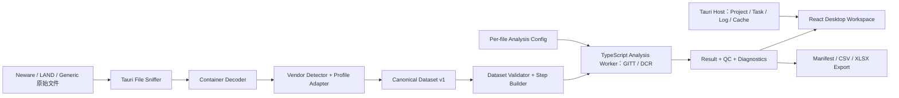

# GITT-DCRMaster Windows 桌面成品实施计划

> 决策日期：2026-07-17
> 正式产品：Windows 10/11 x64 本地桌面软件
> 桌面技术：Tauri 2 + React/Vite + Windows WebView2
> 公开网页演示版：已删除，不在产品路线内
> 计划状态：待实施

## 1. 产品目标

把当前 React/Vite 原型升级为可在实验室长期使用、结果可复核、可安装分发的 GITT/DCR 桌面分析软件。

正式版必须做到：

- 在没有网络、Node、Rust、Python 的普通 Windows 电脑上安装运行。
- 正式支持经过验证的 Neware/新威与 LAND/蓝电导出格式。
- 原始数据始终保留，计算只使用带单位和来源证据的 Canonical Dataset。
- GITT 与 DCR 结果通过合成数据、手算结果和真实仪器文件三层验证。
- 支持文件夹和多文件批量导入、进度、取消、重试和部分失败。
- 支持项目保存、关闭、重新打开并复现相同结果。
- 每次分析都能导出参数、单位、算法版本、质量标志和原始文件哈希。
- 安装包、发布说明、支持格式、已知限制和校验值齐全。

## 2. 明确非目标

- 不开发、部署或维护公开网页演示版。
- Vite 网页构建只用于内部开发、组件测试和 Tauri renderer。
- 首版不提供账号、云同步、多用户协作、远程数据库或遥测。
- 首版不直接控制新威、蓝电测试设备。
- 首版不支持 macOS、Linux、Android、iOS 或正式浏览器运行。
- 首版不把未经充分验证的 GITT/DCR 求解器迁移到 Rust。
- 首版不处理 EISMaster 或 CHI-OPEIS 的融合。

## 3. 成品定义

### 3.1 0.1.0 内部 Beta

- Tauri 安装包可在实验室电脑运行。
- 核心 GITT/DCR golden tests 通过。
- 至少各有一个正式 Neware GITT/DCR profile。
- 至少各有一个正式 LAND GITT/DCR profile。
- 支持项目保存、批量导入、分析和可复现导出。
- 允许存在已知 P2/P3 问题，但不得存在科学结果 P0/P1。

### 3.2 0.9.0 实验室候选版

- 完整 Neware/LAND approved profile 清单通过。
- 经过真实实验室数据连续使用和问题回收。
- 清洁 Windows 10/11 虚拟机完成安装、升级、卸载和离线运行。
- 性能、内存、取消和异常恢复达到本计划预算。

### 3.3 1.0.0 正式版

- 0.9.0 至少经过一轮真实实验使用验证。
- 所有发布阻断项关闭。
- 安装包签名、SHA-256、SBOM、第三方许可证和 CHANGELOG 齐全。
- 支持范围、公式、假设、限制和复算流程经过领域负责人确认。

## 4. 目标架构



### 4.1 React/Vite 层

负责：

- 桌面工作台 UI。
- 文件队列、参数草稿、QC、图表、表格和导出交互。
- 显式运行分析，不在每次输入时自动重算。
- 轻量状态和 Tauri command 调用。

不负责：

- 直接读取任意磁盘路径。
- 供应商容器识别和安全 Excel 解码。
- 项目目录、日志、缓存和更新管理。
- 在主线程执行大文件解析或求解。

### 4.2 Tauri/Rust 层

首版负责：

- Windows 原生文件和文件夹选择。
- 拖放文件路径接收。
- 文件 magic/content sniffing。
- CSV/TXT 编码处理和流式读取。
- Excel/OLE/OOXML 容器识别与安全读取。
- Neware/LAND profile 检测和初步结构提取。
- 项目目录、文件哈希、缓存、日志、任务进度和取消。
- 导出路径权限检查。
- 安装包和应用版本。

首版不负责：

- 重写 GITT/DCR 数值求解器。
- 在没有 golden parity 的情况下替代 TypeScript 算法。

### 4.3 TypeScript Analysis Worker

首版继续承载：

- 工步分析逻辑。
- GITT 端点法和回归法。
- DCR 指定时刻计算。
- SOC/相对进度与质量规则。

前提：

- 只能接收通过 Dataset Validator 的 Canonical Dataset。
- 将当前求解代码抽为纯 TypeScript 核心并运行在 Web Worker，不能运行在 React 主线程。
- 输入和输出必须是稳定、可序列化的版本化合同。
- 后续迁移 Rust 时必须逐 fixture 证明结果等价。

## 5. 建议目录结构

```text
GITT-DCRMaster/
├─ src/
│  ├─ app/                  # React 应用装配、路由、全局错误边界
│  ├─ domain/               # 前端共享类型与结果展示模型
│  ├─ features/
│  │  ├─ project/
│  │  ├─ import/
│  │  ├─ validation/
│  │  ├─ gitt/
│  │  ├─ dcr/
│  │  └─ export/
│  ├─ workers/              # GITT/DCR analysis worker
│  └─ components/
├─ src-tauri/
│  ├─ src/
│  │  ├─ commands/
│  │  ├─ project/
│  │  ├─ import/
│  │  │  ├─ neware/
│  │  │  ├─ land/
│  │  │  └─ generic/
│  │  ├─ task/
│  │  ├─ logging/
│  │  └─ export/
│  └─ capabilities/
├─ tests/
│  ├─ fixtures/
│  │  ├─ neware/
│  │  ├─ land/
│  │  ├─ generic/
│  │  └─ invalid/
│  ├─ golden/
│  └─ e2e/
└─ docs/
```

## 6. 核心数据合同

### 6.1 Canonical Dataset v1

至少包含：

- elapsed_time_s
- step_time_s，可选
- timestamp，可选，并保存时区和来源
- voltage_v
- current_a
- direction：charge、discharge、rest、unknown
- source_step_id
- analysis_step_id
- source_step_type
- cycle_index
- charge_capacity_ah
- discharge_capacity_ah
- net_capacity_ah，仅在语义明确时
- specific_capacity_mah_per_g
- energy_wh
- source_row
- source_sheet
- source_units
- source_sign_convention
- conversion_evidence

规则：

- 内部统一使用 s、V、A、Ah。
- 来源单位和显示单位分开保存。
- Total/Test Time 与 Step Time 不得混用。
- 来源工步与分析切分工步不得使用同一字段。
- 状态列和电流符号冲突时阻止分析或要求人工确认。

### 6.2 Import Report

每个文件必须输出：

- vendor_id
- profile_id
- profile_version
- confidence
- evidence
- container_type
- source_sheet
- detected_columns
- source_units
- source_sign_convention
- unsupported_fields
- warnings
- errors
- source_file_sha256

低置信度不能静默进入求解器。

### 6.3 Analysis Config

按文件保存：

- source_current_unit
- display_current_unit
- current_sign_convention
- discharge_lower_cutoff_v
- charge_upper_cutoff_v
- mass_g
- electrode_area_cm2
- molar_mass_g_per_mol
- molar_volume_cm3_per_mol
- particle_radius_um
- physical_thickness_um
- GITT 模型、方法、倍率、拟合延迟和 iR 修正
- DCR requested offsets

### 6.4 Analysis Manifest

每次运行记录：

- 应用、求解器、解析器版本
- 原始文件哈希
- vendor/profile
- 工作表、列映射、单位和转换依据
- Analysis Config 快照
- 时间重建与工步规则
- 结果、QC、拒绝原因
- DCR requested/actual/bracket time
- 生成时间

## 7. 实施阶段

总工作量预估：单人约 38–58 个有效工作日，不包含等待真实样本、领域审核和代码签名证书的时间。

### 阶段 A：质量基线与合同冻结

预计：2–3 个工作日

任务：

- 修复当前 4 个 lint 错误。
- 固定 Node 24 LTS、npm 11、engines 和 packageManager。
- Vite 升级到安全版本。
- 引入 Vitest、Playwright 和 GitHub Actions。
- 定义 Canonical Dataset v1、Import Report、Analysis Config、Analysis Manifest。
- 修复 standardizeDataWithMeta 返回类型不稳定。
- 建立 raw、canonical、display 三层数据边界。
- 移除或隔离 xlsx 0.18.5 高危依赖。

交付物：

- 测试框架和 CI。
- 版本化 schema。
- 第一批单位、方向和空数据合同测试。

退出标准：

- lint、unit test、build、audit 全绿。
- 生产依赖不存在 high 级漏洞。
- 求解器不能直接接收 raw rows。
- 同一物理数据以 A/mA/µA 表示时，Canonical Dataset 等价。

### 阶段 B：科学真值与核心求解修复

预计：7–10 个工作日

任务：

- 建立可解析解的 GITT/DCR 合成数据生成器。
- 收录实验室手算或认可 Excel 结果。
- 每文件隔离单位、方向、截止条件和参数。
- DCR 改用相邻点插值。
- 保存 requested、actual、bracket、time error。
- 采样率不足或脉冲不足时输出 null 和 QC。
- 统一 GITT valid、review、rejected 规则。
- slope、R²、D 等无效值使用 null，不用 0 伪装。
- 固化平面、球形、物理厚度和四种倍率语义。
- 无可靠容量基准时将 SOC 改为相对分析进度。

交付物：

- 数值 golden 套件。
- 求解器质量规则文档。
- 可复核的 GITT/DCR 结果对象。

退出标准：

- 单位规范化 rtol 不高于 1e-12。
- 合成 DCR rtol 不高于 1e-9。
- 无噪声解析 GITT rtol 不高于 1e-6。
- 真实 golden 容差由领域负责人确认并全部通过。
- 充放电反号并切换 sign convention 后结果保持等价。

### 阶段 C：Neware/新威正式适配

预计：5–8 个工作日

任务：

- 建立 Neware vendor detector、profile 和 adapter。
- 支持批准的 CSV/XLSX profiles。
- 发现目标工作表，不再固定读取第一个 sheet。
- 识别中文/英文表头、元数据行、Cycle/Step/Record 表。
- 区分 Total/Test Time、Step Time 和时间字符串。
- 区分电流、充电容量、放电容量、能量和比容量。
- 优先使用来源状态与工步；启发式只做显式 fallback。
- 加入匿名真实 GITT、DCR 和异常 fixtures。

每个 approved profile 至少需要：

- 一个最小合成 fixture。
- 一个匿名真实 GITT fixture。
- 一个匿名真实 DCR fixture。
- 一个不可恢复 fixture。

退出标准：

- approved fixtures 无人工映射进入 Canonical Dataset。
- 行数、单位、时间、工步、循环和关键结果通过 golden。
- 对 LAND 和通用文件零误识别。
- 未知 Neware 版本进入可恢复确认状态。

### 阶段 D：LAND/蓝电正式适配

预计：5–8 个工作日

任务：

- 建立 LAND vendor detector、profile 和 adapter。
- 识别 OOXML XLSX、BIFF XLS、HTML 伪 XLS 和文本伪 XLS。
- 适配不同 LAND 版本的中文列名、状态值和时间格式。
- 处理合并单元格、重复表头、分页、空行和时间归零。
- 处理同一工步号内的电流水平变化。
- 加入匿名真实 GITT、DCR 和异常 fixtures。

退出标准：

- 相同 .xls 扩展名的不同容器正确路由。
- approved fixtures 的时间、单位、工步、容量和结果全部通过。
- 对 Neware 和通用文件零误识别。
- 不支持的 LAND profile 不会静默套用错误规则。

### 阶段 E：Tauri 2 桌面基础

预计：4–6 个工作日

任务：

- 初始化 src-tauri 和最小 capabilities。
- 配置 Windows WebView2、应用图标、版本和窗口。
- 原生文件/文件夹选择与拖放。
- 前端只接收受控 Import Token，不获得通用磁盘路径读写能力。
- 最近项目、窗口尺寸、位置和最大化状态记忆。
- 项目自动保存与崩溃恢复。
- 建立 app data、cache、log 和 export 目录。
- 建立文件哈希与重复文件识别。
- 建立结构化日志，日志默认不得包含实验原始数据。
- 建立单实例和项目写锁，避免两个进程同时覆盖项目。
- 注册 .gittdcr 文件关联。
- CSP 以 default-src 'self' 为基础，不加载远程脚本、字体、iframe 或页面。
- 默认不申请网络、shell、通用 filesystem 或任意目录访问权限。

项目格式 v1：

- 用户保存一个 project-name.gittdcr 文件。
- 文件内容为版本化 JSON Manifest，保存项目、来源文件、哈希、配置、结果、QC 和 UI 状态。
- 大型 Canonical Dataset 与图表缓存保存到本机工作目录，不写入 JSON。
- 工作目录位于 %LOCALAPPDATA%\GITTDCRMaster\workspaces\<project-id>\。

规则：

- 默认引用原始文件并保存 SHA-256，不复制大文件。
- 源文件移动后允许重新定位，但必须重新校验哈希。
- 保存使用临时文件、内容校验和原子替换，不能直接覆盖最后一个有效项目。
- project schema 必须带版本、迁移和旧版本只读回退。
- 便携归档不是 1.0 阻断项；后续需要时再增加包含原始文件的归档格式。

退出标准：

- 清洁 Windows 10/11 机器可打开应用。
- 无网络时可创建、保存、关闭和重新打开项目。
- 中文、空格、长路径、OneDrive 和只读路径错误均有恢复提示。
- Tauri 权限审查只包含实际需要的能力。
- Release 禁用 DevTools，应用完全离线时不会产生外部网络请求。

### 阶段 F：任务系统、性能与安全解析

预计：5–8 个工作日

任务：

- 建立 Import Job 和 Analysis Job 状态机。
- 支持 queued、running、needs_input、success、failed、cancelled。
- 文件级失败隔离、单文件重试和批量取消。
- 取消请求一秒内生效。
- CSV 流式/分块解析。
- Excel 解码移出 React 主线程。
- Canonical Dataset 使用列式结构或 TypedArray，避免百万行对象。
- Rust 导入后返回 dataset handle 与摘要，不通过 JSON IPC 反复传输几十万行对象。
- 分析时按列读取二进制 ArrayBuffer，并以 transferable 方式交给 Worker。
- React 状态只保存 ID、摘要、选择和视图状态，不保存完整原始数据。
- 修复 O(n²) 工步均值和大数组展开。
- 按 source hash + config hash 缓存分析结果。
- 图表使用保留极值和工步边界的下采样。
- 设置文件大小、sheet 数、行列、解压后大小和任务超时限制。
- 每次分析使用 run_id；取消、失败或迟到结果不得提交到当前项目。

性能参考机：

- Windows x64。
- 4 核 CPU。
- 8 GB RAM。

发布预算：

- 主 UI 单次阻塞不超过 100 ms。
- 取消请求一秒内生效。
- 10 × 100k 行批量在参考机 60 秒内完成。
- 1 × 500k 行 CSV 不崩溃。
- 1 × 250k 行 XLSX 不崩溃。
- 峰值内存低于 1.5 GB。
- 处理期间滚动、文件队列和取消按钮保持响应。

退出标准：

- 20 个成功、需确认和失败文件的混合批次可部分完成。
- Worker 完成顺序不同不改变最终结果排序。
- 恶意、损坏、加密和超限文件不会冻结界面。
- 相同输入和配置可复用缓存，修改参数只重算受影响阶段。

### 阶段 G：桌面科研工作台 UI/UX

预计：7–10 个工作日

信息架构：

1. 开始与最近项目。
2. 数据文件队列。
3. 数据与单位校验。
4. 分析参数。
5. 运行与任务状态。
6. QC、图表和结果表。
7. 导出与复算信息。

桌面布局：

- 左侧：项目、数据集和文件队列。
- 中间：时间线、GITT/DCR 图表和结果表。
- 右侧：当前文件参数、单位、解析证据和 QC。
- 底部状态栏：任务、进度、内存、应用版本和日志入口。

交互要求：

- 参数采用草稿值、失焦校验和显式“运行分析”。
- 错误必须说明原因、影响和恢复动作。
- 模态框支持 Escape、初始焦点、焦点陷阱和返回焦点。
- 文件删除提供确认或撤销。
- 支持 Ctrl+O、Ctrl+Shift+O、Ctrl+S、Ctrl+R、Ctrl+E。
- 状态消息使用 aria-live，关键操作可全键盘完成。
- 不使用 emoji 作为结构图标。
- 动画仅用于状态变化，并尊重 reduced-motion。

视觉系统：

- 精密实验室工作台，而非营销页。
- 使用中性表面与一个冷色主色。
- 橙色只表示警告，红色只表示错误，绿色只表示 QC 通过。
- 使用语义颜色 token，禁止组件内随意硬编码颜色。
- 数值使用等宽字体；正文使用系统或随包字体。
- 不在运行时请求 Google Fonts 或其他网络资源。

图表要求：

- 时间轴必须是真实线性时间轴。
- 多文件同时使用颜色、线型和点型区分。
- 支持缩放、十字准线、固定 Tooltip 和数据点定位。
- 标记截止区、异常点、拟合窗口和 rejected 点。
- 图表必须有文本摘要和数据表替代。
- 大于 1000 点使用 Canvas 和下采样。

窗口与 DPI 验收：

- 1024×720。
- 1366×768。
- 1920×1080。
- 100%、125%、150%、200% Windows DPI。
- 最大化、恢复和多显示器切换。

退出标准：

- 无窗口级横向溢出。
- 键盘可完成导入、确认、运行、查看和导出。
- 自动无障碍检查无 critical/high。
- 表格、图表和检查器在最小窗口仍可访问。

### 阶段 H：可复现导出与 Windows 发布

预计：3–5 个工作日

任务：

- 导出稳定 JSON、CSV 和 XLSX。
- CSV 固定 UTF-8、数值格式和列顺序。
- 防止 CSV/Excel formula injection。
- XLSX 通过 Microsoft Excel 和 WPS 验收。
- 增加 README、算法说明、支持格式、已知限制和故障排查。
- 增加 LICENSE、CHANGELOG、第三方许可证和 SBOM。
- 使用 Tauri 构建 Windows NSIS 安装包。
- 首发采用 per-user NSIS，默认不要求管理员权限。
- 提供普通安装包，并为断网实验室准备包含 WebView2 bootstrapper/runtime 的离线安装方案。
- 生成 SHA-256。
- 有证书时使用 Windows Authenticode 签名安装包。
- 自动更新包还必须使用独立的 Tauri updater 签名。
- 自动更新只在两类签名和稳定更新源就绪后启用；否则首版关闭。
- 卸载不得删除用户项目、导出文件和日志；缓存通过应用内功能单独清理。

Windows 验收：

- Windows 10 22H2 x64。
- Windows 11 23H2/24H2 x64。
- zh-CN 与 en-US locale。
- 清洁虚拟机，无开发工具。
- 普通用户权限。
- 完全离线启动、导入、分析和导出。
- 首次安装、覆盖安装、旧版本升级、卸载。
- Windows Defender 与常用企业杀毒扫描。

发布阻断：

- 任一未关闭的科学 P0/P1。
- approved vendor profile 误识别。
- high 级生产漏洞。
- 大文件可稳定触发冻结或崩溃。
- Analysis Manifest 无法复算。
- 清洁 VM 无法安装或离线运行。

## 8. 测试体系

### 8.1 单元测试

- 单位转换与 SI 规范化。
- 电流方向和状态冲突。
- 时间字符串解析。
- 工步切分。
- DCR 插值和边界。
- GITT 模型、拟合和 QC。
- Manifest 序列化与迁移。

### 8.2 供应商解析 golden

- vendor/profile 检测。
- 容器、工作表和表头定位。
- 来源单位和符号。
- 行数、首行、中间行和末行。
- 工步、循环和容量语义。

### 8.3 科学计算 golden

- 解析解合成数据。
- 实验室手算或认可 Excel。
- Neware GITT/DCR 真实结果。
- LAND GITT/DCR 真实结果。
- 每个 golden 保存公式版本、参数、容差、审核人和 SHA-256。

### 8.4 失败测试

- 缺失时间、电压或电流。
- 单位冲突。
- 状态和符号冲突。
- 非单调、重复或归零时间。
- 采样率不足。
- 损坏、加密、宏、外部链接、zip bomb 和超限文件。
- 导出目录无权限或输入文件被锁定。

### 8.5 端到端测试

- 新建项目。
- 批量导入。
- 自动识别与人工确认。
- 修改参数并运行。
- 取消和重试。
- 保存、关闭并重新打开。
- 导出并用 Manifest 复算。
- 打包后应用 smoke test。

## 9. 需要提供的实验数据

开始阶段 C/D 前，需要准备脱敏样本：

Neware：

- 中文和英文导出各一份。
- GITT 与 DCR 各至少两份。
- CSV 与 XLSX。
- 包含 Total/Test Time 与 Step Time。
- 包含充/放容量分列和 Cycle/Step。
- 一个异常或损坏文件。

LAND：

- GITT 与 DCR 各至少两份。
- 真 XLS、XLSX、HTML/文本伪 XLS 中实际使用的类型。
- 至少两个软件版本或导出 profile。
- 包含时间归零、重复表头或分页的复杂样本。
- 一个异常或损坏文件。

领域真值：

- 至少一组人工手算 GITT。
- 至少一组人工手算 DCR。
- 当前实验室认可的 Excel 计算模板或结果表。
- 对 GITT 模型、倍率、iR 修正和拟合窗口的正式说明。

真实文件进入仓库前必须匿名化；大文件使用 LFS 或发布资产，并保存 SHA-256。

## 10. PR 拆分顺序

1. PR-01：lint、运行时固定、Vite 安全升级、Vitest/CI。
2. PR-02：Canonical Dataset、Import Report、Analysis Config、Manifest。
3. PR-03：每文件单位/方向/截止隔离。
4. PR-04：DCR 插值、requested/actual 和 QC。
5. PR-05：GITT 质量门控与 golden tests。
6. PR-06：Neware detector/profile/adapter。
7. PR-07：LAND container sniffer 与 adapter。
8. PR-08：Tauri 2 壳、文件夹导入、项目格式和日志。
9. PR-09：Import/Analysis Job、进度、取消、缓存和 Worker。
10. PR-10：桌面工作台信息架构与窗口/DPI 修复。
11. PR-11：图表、表格、无障碍和键盘工作流。
12. PR-12：可复现导出、文档、安装包和 Release Candidate。

每个 PR 必须：

- 有对应测试。
- 不改变无关功能。
- 记录迁移或兼容影响。
- 通过 lint、test、build、audit。
- 涉及数值结果时附 golden 对比。

## 11. 最终发布门槛

只有同时满足以下条件，才能称为成品：

- GITT/DCR 科学结果通过正式 golden。
- Neware/LAND 支持范围由 approved profiles 明确定义。
- 未验证格式不会静默计算。
- 所有结果可由原始文件和 Manifest 复算。
- 批量、大文件、取消和失败隔离达到预算。
- Windows 安装、离线运行、升级和卸载通过。
- 无 high 生产漏洞，无科学 P0/P1。
- 文档能让新用户独立完成导入、校验、计算、QC 和导出。
- 正式产品不存在公开网页演示版维护义务。
