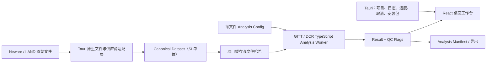

# GITT-DCRMaster 优化与升级路线图

> 基线日期：2026-07-17
> 基线提交：6088adba4dae781e200748fb8d9e437505dd7e7b
> 当前阶段：完成首次审查与产品形态决策，正式目标为 Windows Tauri 桌面软件
> 详细桌面实施计划：docs/DESKTOP_PRODUCT_PLAN.md

## 1. 结论

项目已经具备可运行的 React + Vite 单页应用雏形，支持 GITT、DCR、CSV/TXT/Excel 导入、图表和结果导出。生产构建能够通过，但目前不适合直接作为可信科研分析工具发布。

正式产品确定为 Windows 10/11 x64 本地桌面软件：保留 React/Vite 作为界面与内部开发环境，使用 Tauri 2 提供桌面壳、原生文件能力、项目持久化、日志、安装包和后续原生任务能力。公开网页演示版已从路线中删除，不作为首版或正式版交付物。

升级顺序必须是：

1. 先修复单位、截止条件、DCR 采样时刻等科学结果可信度问题。
2. 建立实验室认可样本、golden tests、CI 和安全基线。
3. 建立 Neware/新威和 LAND/蓝电的正式供应商适配器。
4. 重构导入、规范化、求解和结果质量控制的数据链路。
5. 加入 Tauri 桌面基础设施、大文件任务系统和桌面工作台。
6. 最后补齐可复现实验导出、安装包、文档、版本与发布流程。

## 2. 当前基线

| 项目 | 当前状态 |
| --- | --- |
| 当前技术栈 | React 19、Vite 8、Chart.js、PapaParse、SheetJS xlsx |
| 目标运行时 | Tauri 2 + React/Vite + Windows WebView2 |
| 正式平台 | Windows 10/11 x64 |
| 安装 | npm ci 成功，149 packages |
| 构建 | npm run build 成功 |
| 代码检查 | npm run lint 失败，4 个错误 |
| 自动测试 | 无 test 脚本、无测试文件 |
| CI | 无 |
| 生产安全 | xlsx 0.18.5 存在 2 个 high 级漏洞 |
| 开发安全 | Vite 8.0.13 在 Windows 上存在 high 级漏洞，可升级到 8.1.5 |
| 生产包 | 单一 JS 约 880.62 kB，gzip 约 291.32 kB |
| 文档 | README 仍是 Vite 模板 |
| 版本 | package version 为 0.0.0 |
| 布局 | 结果区存在 Grid 最小宽度溢出，窄窗口和高 DPI 下不可用 |

### 2.1 产品形态与非目标

正式目标：

- Windows 本地桌面软件，默认完全离线运行。
- 原始测试文件不上传服务器。
- 支持文件、文件夹、批量任务、项目保存与恢复。
- 支持 Neware/新威和 LAND/蓝电测试数据。
- 一个安装包完成运行，不要求用户安装 Node、Rust 或 Python。

明确非目标：

- 不发布或维护公开网页演示版。
- 首版不提供云同步、账号、多用户协作或远程数据库。
- 首版不直接控制新威、蓝电或其他测试设备。
- 首版不承诺 macOS、Linux、移动端或浏览器正式支持。
- 不在科学核心验证完成前把 GITT/DCR 求解器重写为 Rust。

## 3. 产品与设计基线

### 视觉命题

把产品设计成“精密实验室分析工作台”：中性深灰或浅灰表面、一个冷色主色、克制的边框与层级；橙色只表示警告，红色只表示错误，绿色只表示质量通过。减少泛光、玻璃拟态和装饰性渐变，数值使用等宽字体，说明文字保持高对比。

### 内容计划

1. 文件队列：上传、解析状态、供应商格式和错误恢复。
2. 数据校验：列映射、来源单位、方向、时间轴、容量字段与诊断。
3. 参数配置：基础参数、高级模型选项和每个文件的分析配置。
4. 运行分析：显式运行、进度、参数快照和取消。
5. QC 复核：拟合质量、排除原因、采样误差、异常工步。
6. 结果与导出：联动图表、数据表和可复现 Analysis Manifest。

### 交互命题

- 文件导入采用可恢复的状态流：等待、解析、需映射、校验失败、就绪。
- 参数编辑先保留草稿，校验通过后显式运行分析；结果始终绑定参数快照。
- 图表、表格和工步选择联动；质量警告可定位到具体文件、工步和原始数据。
- 动效只用于状态过渡、选中关系和分析进度，并支持 prefers-reduced-motion。

## 4. 目标数据架构

核心约束：

- Raw Dataset、Canonical Dataset、Steps、Analysis Result 必须是不同的数据对象。
- 来源单位 source unit 与显示单位 display unit 必须分离。
- 电流方向、截止电压、时间覆盖和模型参数必须按文件保存。
- 求解器只接收 SI 单位和已验证配置。
- 所有结果必须携带算法版本、参数快照、质量标志和诊断信息。
- Neware、LAND 与通用格式必须通过独立 Adapter 进入 Canonical Dataset。
- Tauri/Rust 首先承担文件、项目、解析、日志和任务调度；求解器首版保留在经过测试的 TypeScript Worker 中。
- 任意 Rust 算法迁移必须通过相同 golden fixtures 的逐项等价验证。

## 5. 发布阻断项

### 5.1 多文件配置相互污染

当前新导入文件会修改全局截止电压，并触发所有旧文件重算。混合充放电文件时，旧文件结果会被静默改变。

修复方向：

- 每文件保存 currentSignConvention、dischargeLowerCutoff、chargeUpperCutoff。
- 新文件的建议值只作用于该文件。
- 增加“导入另一个文件不得改变既有结果”的回归测试。

退出标准：

- 同时导入充电与放电文件，任一文件的结果和排除状态保持独立。

### 5.2 来源电流单位无法被用户真正纠正

当前“电流物理单位”控件主要改变显示和导出，求解仍使用导入时固化的 nativeCurrentUnit。误判 A/mA 时，DCR 可能出现 1000 倍误差。

修复方向：

- 每文件保存可编辑的 sourceCurrentUnit。
- 导入完成后立即转换为 A。
- 独立提供 displayCurrentUnit。
- 图表、求解器和导出统一读取 Canonical Dataset。

退出标准：

- 同一物理数据分别用 A、mA、uA 表达时，规范化后的 GITT/DCR 结果在容差内一致。

### 5.3 DCR 名义时刻与实际采样时刻不一致

当前 0.1s、1s、10s DCR 使用最近邻采样点，但界面和导出仍标为精确时刻。内置 0.5s 采样样本的 0.1s DCR 实际取到 t=0。

修复方向：

- 使用相邻点插值。
- 记录 requestedTime、actualTime、timeError。
- 采样率不足时返回 null，并给出 unsupported_sampling 质量标志。
- 脉冲长度不足时不再使用宽松的 85% 规则。

退出标准：

- 每个 DCR 结果都能追溯到实际采样或插值区间。
- 不可支持的时刻不会生成看似精确的数值。

### 5.4 Excel 解析依赖存在 high 级漏洞

xlsx 0.18.5 同时用于用户文件解析和结果导出，npm 源当前无可直接修复版本。

修复方向：

- 先完成替代方案验证：官方修复版 SheetJS、维护中的替代库，或拆分导入/导出库。
- 在替代完成前增加文件大小、行列数、工作表数和超时限制。
- 解析移入 Web Worker。
- 若业务允许，优先停止旧 .xls 支持，仅保留受控的 .xlsx 与 CSV。

退出标准：

- npm audit --omit=dev 不再包含 high 级生产漏洞。
- 恶意或超大 Excel 文件不能冻结主界面。

### 5.5 结果页在桌面窄窗口和高 DPI 下不可用

结果表的最小宽度会撑开 Grid，body 又隐藏横向溢出。该问题在 Tauri 窗口缩放、1366×768 笔记本和 Windows 150%/200% DPI 下会直接造成内容不可见。

修复方向：

- Grid 使用 minmax(0, 1fr)，关键 Grid/Flex 子项统一 min-width: 0。
- 宽表滚动只发生在 table-container 内。
- 为 Tauri 设置合理最小窗口尺寸，并在更小的可用内容区切换为折叠检查器。
- 支持最大化、恢复、窗口尺寸记忆和 Windows DPI 缩放。

退出标准：

- 1024×720、1366×768、1920×1080 均无窗口级横向溢出。
- 100%、125%、150%、200% DPI 下核心操作和结果均可访问。
- 参数检查器可折叠，结果区不被完整高级参数永久推到屏幕之外。

## 6. 分阶段实施计划

### M0：建立安全和回归基线

优先级：最高
规模：M

任务：

- 修复现有 4 个 lint 错误。
- 固定 Node 24 LTS、npm 11 和 packageManager/engines。
- Vite 升级到 8.1.5，刷新可安全更新的 patch/minor 依赖。
- 完成 xlsx 替代方案 spike，并记录选择、来源和校验方式。
- 引入 Vitest、Playwright 和 GitHub Actions。
- 建立 lint → unit test → integration test → build → audit 的质量门禁。
- 保留当前算法输出快照，但不要把已知错误固化为“正确答案”。

退出标准：

- lint、test、build 全绿。
- CI 可重复运行。
- high 级生产依赖漏洞清零或有明确、短期、可审计的隔离措施。

### M1：修复科学计算可信度

优先级：最高
规模：L

任务：

- 建立每文件 Analysis Config，隔离单位、方向、截止条件和模型参数。
- 建立 Canonical Dataset，时间统一为 s、电流统一为 A、电压统一为 V、容量带明确维度。
- 修复 DCR 指定时刻插值、采样能力判断和质量标志。
- 明确 GITT/DCR 电流正负方向，并允许按设备/文件覆盖。
- 统一 GITT 拟合质量规则：valid、review、rejected。
- 将 slope/R² 无效值由 0 改为 null，并保存拒绝原因。
- 没有额定容量、初始 SOC 和可靠容量基准时，将 SOC 改称“相对分析进度”。
- 导出全部参数、单位、映射、算法版本、拟合窗口和质量标志。

退出标准：

- 通过实验室认可的手算或发表数据 golden tests。
- 单位换算、方向、截止条件和采样率测试全部通过。
- 图表默认不展示 rejected 结果。

### M2：重构解析和导入流程

优先级：高
规模：L

任务：

- 列映射唯一化，禁止 Step Time 同时映射为 time 和 step。
- 映射结果增加置信度；低置信度进入人工确认。
- 表头单位优先于容量反推，支持 s/min/h、hh:mm:ss。
- 区分 mAh、Ah、mAh/g、Wh、Wh/g，禁止混为同一容量字段。
- 明确定义小数点/十进制逗号策略，不能把 1,23 静默解析为 123。
- 优先使用可信来源工步类型；否则引入可配置静置噪声阈值、滞回和最短工步时长。
- standardizeDataWithMeta 始终返回稳定结构或抛出领域错误。
- 批量上传改为按文件 ID 隔离的 Import Job 队列，支持重试、取消和逐项映射。
- 增加文件哈希，防止重复导入并支持结果追溯。

退出标准：

- Neware/新威与 LAND/蓝电的 approved fixtures 均能明确解析或给出可恢复错误。
- 多个需手动映射的文件不会相互覆盖状态。

### M3：性能与工程架构升级

优先级：高
规模：M/L

任务：

- 将 App.jsx 中的导入、配置、求解状态拆分为 reducer/hooks。
- 建立 Raw → Canonical → Steps → Result 单向管线。
- 仅运行当前模式需要的求解器。
- 按文件和配置哈希缓存标准化、分组和求解结果。
- 修复工步均值 O(n²) 路径，使用 running sum。
- 移除 Math.min(...largeArray) 和 Math.max(...largeArray)。
- 文件解码和供应商解析移入 Tauri/Rust；GITT/DCR 求解首版移入 TypeScript Web Worker，提供进度和取消。
- 增加 Error Boundary，所有导入/求解异常都转为可恢复状态。
- 动态加载 Excel、图表和导出模块。
- 为初始包、Excel chunk 和图表 chunk 建立 bundle budget。
- 在核心领域对象稳定后，增量迁移到 TypeScript，并为单位建立明确类型。

退出标准：

- 参数变更不会重复解析原始文件。
- 大文件处理不阻塞输入和滚动。
- 首屏不加载 Excel 和图表重依赖。

### M4：科研工作台 UI/UX 重构

优先级：中高
规模：M/L

任务：

- 桌面端采用文件队列、主工作区、参数/QC 检查器三段结构。
- 窄桌面窗口采用可折叠检查器，结果区保持优先。
- 基础参数与高级模型选项分层。
- 输入使用草稿值、失焦校验、物理范围提示和显式“运行分析”。
- 上传入口改为原生可聚焦控件或正确关联的 label/input。
- 所有 label 与 input/select 建立关联；状态区使用 aria-live。
- 映射弹窗加入 dialog 语义、焦点圈、焦点陷阱、Escape 和返回焦点。
- 模式切换使用 tab 或 aria-pressed 语义。
- 页面语言改为 zh-CN，修正标题层级。
- 点击目标不小于 44×44px；修复文本和按钮对比度。
- 增加删除确认或可撤销提示。
- 尊重 prefers-reduced-motion。

图表专项：

- 时间线改为真实线性时间轴，不再用 CategoryScale 表示不等间隔采样。
- 下采样采用保留极值和工步边界的算法，而非固定步长抽样。
- 多文件同时使用颜色、线型和点型区分。
- 增加图表文本摘要、图表/数据表切换、键盘可达 Tooltip。
- 增加缩放、十字准线、截止区与异常点注释。
- 表格增加 caption、scope、排序、冻结表头/首列和独立横向滚动。

退出标准：

- 1024×720、1366×768、1920×1080 和 100%–200% Windows DPI 全部通过布局测试。
- 键盘可完成上传、映射、参数编辑、运行、查看和导出。
- 自动无障碍检查无 critical/high 问题。

### M5：可复现导出、文档与发布

优先级：中
规模：M

任务：

- 每次分析生成 Analysis Manifest：
  - 文件名、哈希、编码、工作表和列映射
  - 来源单位、规范化单位和检测依据
  - 全部材料、模型与求解参数
  - 算法/应用版本、时间戳
  - 拟合质量、排除原因和警告
  - DCR requested/actual time 与误差
- 重写 README：用途、支持格式、算法假设、示例、限制、开发和发布。
- 增加 CHANGELOG、版本策略和发布检查表。
- 决定并补充 LICENSE。
- 发布首个经过验证的 0.1.0，而不是继续使用 0.0.0。

退出标准：

- 任一导出结果可由 Manifest 和原始文件重新计算并复核。
- 新用户可仅依赖 README 完成安装、导入、分析和结果解释。

## 7. 必须建立的测试矩阵

| 类别 | 必测场景 |
| --- | --- |
| 单位 | A/mA/uA 等价输入；s/min/h；mAh/Ah；错误单位人工覆盖 |
| 多文件 | 充放电混合、不同来源单位、不同截止电压、不同材料参数 |
| DCR | 0.1/1/3/5/10s 插值；采样率不足；脉冲不足；大小电流配对 |
| GITT | 平面/球形/物理厚度；四种倍率；端点法/回归法；iR 修正 |
| 拟合 | 低 R²、点数不足、斜率接近 0、未充分弛豫 |
| 工步 | 来源 step ID、无 step ID、漏电噪声、阶跃电流、时间重置 |
| 映射 | Step Time、Total Time、Step Index、重复列、低置信度 |
| 文件 | UTF-8、GBK/GB18030、CSV/TXT/XLSX、多工作表、空文件、超大文件 |
| 数值 | NaN、Infinity、负值、零面积/质量、非单调时间、重复时间 |
| UI | 桌面最小窗口、Windows DPI、键盘、屏幕阅读器、modal、aria-live、删除撤销 |
| 导出 | 参数快照、Manifest、质量标志、算法版本和结果复算 |

## 8. 需要领域专家确认的决策

以下内容不能仅靠代码审查定案，必须用实验室规范或认可样本确认：

- 不同设备的电流正负方向约定。
- GITT 特征长度 L 的三种定义及适用边界。
- 4/π、1/π、4、1 四种倍率的业务含义和默认值。
- E0/E2 是否已达到平衡，以及弛豫判定阈值。
- iR 修正后脉冲时长和拟合窗口的规范。
- 实际 SOC 的基准、初始值和脉冲前/后定义。
- Neware/新威与 LAND/蓝电各导出 profile 的正式支持范围。

在这些决策完成前，界面应明确显示“假设、来源和质量状态”，不能把启发式结果呈现为无条件有效。

## 9. 实施入口

完整阶段、工期、Tauri 架构、Neware/LAND fixture 矩阵、Windows 验收和 12 个 PR 的拆分顺序，以 docs/DESKTOP_PRODUCT_PLAN.md 为准。
